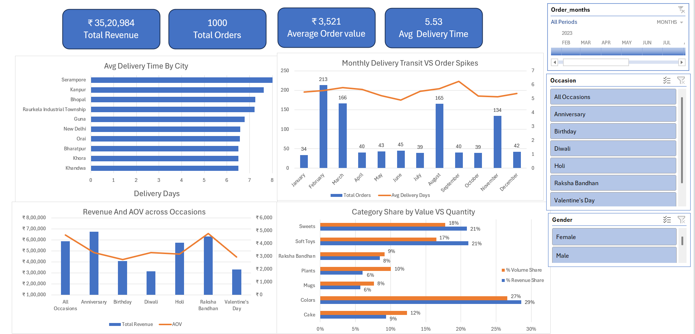

# E-Commerce Gifting Platform: Operations & Sales Diagnostic

## 📊 Project Overview
This project presents an end-to-end operational and sales analysis for an online direct-to-consumer (D2C) gifting platform. The platform fulfills orders across major Indian festivals (Diwali, Raksha Bandhan, Holi) and personal occasions (Birthdays, Anniversaries, Valentine's Day).

While typical e-commerce analysis focus exclusively on top-line revenue, gifting operations require strict delivery turnaround times (SLA) to prevent gift delays and churn. Using Excel's analytical engine (Power Query, Power Pivot Data Model, and DAX), this project evaluates 1,000 transactions across 2023 to balance commercial growth with supply chain efficiency.

---

## 🛠️ Tools & Analytical Techniques
- **Microsoft Excel:** Executive Dashboard interface, dynamic Slicers, and dual-axis visualization.
- **Power Query:** Data extraction, type transformation, text standardization, and transit day calculations.
- **Power Pivot (Data Model):** Star Schema relational architecture connecting Fact and Dimension tables natively.
- **Data Analysis Expressions (DAX):** Formulated explicit calculated measures (`Total Revenue`, `Total Orders`, `AOV`, `Avg Delivery Days`).

---

## ❓ Key Business Questions Answered
1. **Total Commercial Performance:** What is the total realized gross revenue across the platform?
2. **Order Volume & Sizing:** How many completed orders were fulfilled, and what is the platform Average Order Value (AOV)?
3. **Logistics Turnaround Times:** What is the platform-wide average delivery lead time from order placement to customer receipt?
4. **Regional Fulfillment Bottlenecks:** Which specific destination cities experience the longest delivery transit delays?
5. **Seasonal Volume Surges:** Across the 12 calendar months, when do order spikes occur, and does high demand stress fulfillment lead times?
6. **Occasion Economics:** Which festive and personal events generate the highest total revenue versus average basket spending?
7. **Product Category Split:** Which product categories drive the greatest share of revenue versus unit sales volume?
8. **Customer Gender Segmentation:** How do purchasing behaviors and basket allocations vary across male and female customer cohorts?

---

## 📂 How to Explore This Project
1. **Explore the Excel File:** Download and open `Gifting Analysis.xlsx`. Slicers (`Occasion`, `Gender`, `Timeline`) are unlocked to test dynamic filtering across the visual layout.
2. **Review the Documentation:** Refer to `Problem_Statement.pdf` for the analytical scope and `Executive_Summary.pdf` for executive takeaways.
3. **Quick Visual Review:** View the dashboard preview directly below if you do not have Excel installed.

---

## 📸 Dashboard Preview

*Figure 1: Executive Dashboard featuring KPI ribbons, regional transit lead times, dual-axis order spikes, occasion spending, and category volume-to-value share.*

---

## 🔍 Key Insights & Analytical Findings
* **Financial Performance:** The platform generated **₹35,20,984** across **1,000 orders**, yielding an overall **Average Order Value (AOV) of ₹3,521**.

* **Regional Supply Chain Stress:** Delivery lead times average **5.53 days** overall. However, significant delivery delays appear in Tier-2 cities—**Serampore and Kanpur average 8.0 transit days**, followed by Bhopal, Rourkela, Guna, and New Delhi averaging **7.0 days**.

* **Seasonal Holiday Surges:** Monthly transactions peak sharply around festive calendars—**February** (213 orders for Valentine's Day), **March** (166 orders for Holi), and **August** (165 orders for Raksha Bandhan). Average delivery transit times hover between 5.0 to 6.0 days during these periods.
* **Occasion Spending Disparities:** **Anniversary** purchases generated the largest overall sales volume (**₹6,74,634**), while **Raksha Bandhan** recorded the highest customer basket size with an **AOV of ₹4,785**. Routine occasions like Birthdays averaged a lower basket of ₹2,740.
* **Category Volume vs. Value Share:** 
  * **Colors** purchased on Holi festival represents the primary value engine, driving **29% of total revenue** and 27% of volume.
  * **Soft Toys** (21% value vs. 17% volume) and **Sweets** (21% value vs. 18% volume) demonstrate **high margin** efficiency.
  * **Cakes** generate 12% of unit sales volume but contribute only 9% of total revenue, representing an lower value ticket item.

---

## 🔚 Business Recommendations
1. **Regional Logistics Optimization:** Partner with regional third-party logistics carriers or dispatch hubs in high-transit zones (Kanpur and Serampore) to reduce fulfillment lead times closer to a 3–4 day window.
2. **Bundling Products for Low-Ticket Lines:** Bundle high-frequency, lower-value items (such as Cakes and Mugs) with premium Sweets and Hampers during festival peaks to lift transaction sizes above ₹3,500.
3. **Customer Retention Automation:** Target customers acquired during peak holidays (Valentine's Day, Raksha Bandhan) with automated advance reminders 14 days ahead of personal occasions (Birthdays, Anniversaries).

---

## 👤 Author & Contact
- **Author:** [Sumit Shaw]
- **LinkedIn:** [[LinkedIn Profile](https://www.linkedin.com/in/sumitshaw20?utm_source=share_via&utm_content=profile&utm_medium=member_android)]
